  &nbsp;
  &nbsp;
  

📍 <b>Sharjah, UAE</b> &nbsp;|&nbsp; 🌍 <b>Open to Remote Opportunities</b>

  &nbsp;
  &nbsp;
  &nbsp;
  

---

## 👩‍💻 About Me

  

### 🎯 What I Work On

  

---

## 🧰 Tech Stack

  

---

# 🏆 Completed Hackathon Projects

> Five completed and submitted hackathon projects spanning **agentic AI, RAG, financial automation, civic technology and career intelligence**. Click any card to open the code.

<table>
<tr>
<td width="50%" align="center" valign="top">

 
  
</td>
<td width="50%" align="center" valign="top">

 
  
</td>
</tr>
<tr>
<td width="50%" align="center" valign="top">

 
  
</td>
<td width="50%" align="center" valign="top">

 
  
</td>
</tr>
</table>

 
  

---

# 💼 QuantumLogics Internship

 

 
Evaluated on a hand-written suite of 271 cases: 74.54% accuracy, 77.50% precision, 68.89% recall (vulnerable class).

---

# ⭐ Featured AI Projects

▸ Click a project to expand

<b>🛡️ PromptGuard</b> &nbsp;·&nbsp; <i>Automated security testing for LLM applications</i>

 

Security-testing platform for systematically evaluating LLM applications against adversarial inputs and unsafe behavior.

- 🔐 Tests LLM applications against prompt-injection and adversarial scenarios
- 🧪 Automates repeatable security evaluations instead of relying only on manual testing
- 📊 Structures results so vulnerabilities can be inspected and compared
- 🛡️ Demonstrates practical AI red-teaming and LLM application security

`Python` `LLM Security` `Red Teaming` `OpenAI API`

<b>🔎 Scoutly</b> &nbsp;·&nbsp; <i>AI research & document intelligence assistant</i>

 

Research assistant for retrieving information from uploaded documents and generating grounded responses.

- 📚 Converts uploaded research documents into a searchable knowledge base
- 🔎 Retrieves relevant evidence before generating responses
- 💬 Produces grounded answers using supporting document context
- ⚙️ Separates the FastAPI AI service from the Django user-facing dashboard

`FastAPI` `Django` `RAG` `ChromaDB` `PostgreSQL`

---

# 🎓 MSc Artificial Intelligence Projects

▸ Click a project to expand

<b>📡 Real-Time Twitter Sentiment Analysis</b> &nbsp;·&nbsp; <i>MSc Dissertation · 2.39M tweets</i>

 

End-to-end real-time sentiment analysis system combining distributed streaming, machine learning and cloud deployment.

- 📊 Built and evaluated using a **2.39M-tweet dataset**
- ⚡ Streams incoming data through **Apache Kafka and Spark Structured Streaming**
- 🧠 Combines TF-IDF, numerical features and MiniLM embeddings for classification
- 🌐 Delivers predictions through MongoDB and a real-time Django dashboard

`Python` `Kafka` `Spark` `NLP` `MongoDB` `Django`

<b>📧 Spam Email Classification</b> &nbsp;·&nbsp; <i>NLP classification · 98.95% accuracy</i>

 

Machine-learning pipeline for identifying spam messages from textual email content.

- 📝 Transforms email text into machine-readable TF-IDF representations
- 🤖 Applies supervised ML classification to distinguish spam from legitimate email
- 🎯 Achieved **98.95% accuracy** and **97.72% F1-score**
- 📈 Evaluated classification performance with an **AUC of 0.980**

`Python` `Scikit-learn` `NLP` `TF-IDF`

<b>⚖️ Responsible AI</b> &nbsp;·&nbsp; <i>Fairness · Interpretability · Privacy</i>

 

Responsible-ML project examining how predictive performance interacts with fairness, transparency and privacy.

- ⚖️ Evaluates bias and applies mitigation approaches including reweighting and post-processing
- 🔍 Uses SHAP to explain how individual features influence predictions
- 🔐 Examines privacy-preserving ML through differential-privacy case studies
- 📊 Connects model evaluation with practical responsible-AI considerations

`Scikit-learn` `XGBoost` `SHAP` `Responsible AI`

<b>🚢 Titanic Survival Prediction</b> &nbsp;·&nbsp; <i>ML group project · 88.64% best accuracy</i>

 

End-to-end classification project comparing multiple ML approaches for passenger-survival prediction.

- 🤖 Compared six machine-learning approaches on the same prediction task
- 🔍 Investigated feature selection and its effect on predictive performance
- 🌲 Random Forest produced the strongest result using selected features
- 🎯 Achieved a best accuracy of **88.64%**

`Python` `Scikit-learn` `Random Forest` `Machine Learning`

---

# 💻 Additional Projects

▸ Click a project to expand

<b>🤖 AI Interview Practice Bot</b> &nbsp;·&nbsp; <i>Full-stack Django AI app</i>

 

AI-assisted interview preparation application for practicing questions and receiving structured feedback.

- 💬 Provides interactive interview-question practice
- 📊 Evaluates responses through automated scoring
- 🧠 Generates adaptive feedback to support improvement
- 🌐 Built as a full-stack Django AI application

`Django` `Python` `REST API` `AI`

<b>🌍 Climate & Weather Dashboard</b> &nbsp;·&nbsp; <i>Interactive environmental dashboard</i>

 

Interactive dashboard for exploring weather conditions and environmental information.

- 🌤️ Integrates real-time weather information through external APIs
- 🌬️ Presents air-quality information alongside weather conditions
- 📊 Visualizes environmental data through an interactive dashboard
- 💡 Provides contextual recommendations based on retrieved conditions

`Django` `Python` `Chart.js` `Weather API`

---

# 📱 Android Development

▸ Click a project to expand

<b>😊 Mood Journal</b> &nbsp;·&nbsp; <i>Kotlin · Jetpack Compose</i>

 

Privacy-focused Android application for recording moods and tracking emotional patterns over time.

- 🔐 Protects journal data through PIN-based access
- 🔥 Tracks journaling streaks to encourage consistent use
- 📊 Visualizes mood patterns and historical trends
- 📄 Generates PDF reports from recorded data

`Kotlin` `Jetpack Compose` `Android`

<b>🧠 Quiz Master</b> &nbsp;·&nbsp; <i>Kotlin · Jetpack Compose</i>

 

Feature-rich Android quiz application with competitive and progression-oriented functionality.

- 🎯 Provides timed quiz sessions across interactive question flows
- 🏆 Includes achievement and leaderboard functionality
- 👥 Supports competitive and multiplayer-oriented features
- 📱 Built with a modern declarative Android UI using Jetpack Compose

`Kotlin` `Jetpack Compose` `Android`

---

# 🏅 Highlights

  

---

# 📊 GitHub Analytics

---

# 📫 Let's Connect

### Open to opportunities in

**AI/ML Engineering • Applied AI • Agentic AI • LLM Applications • Software Engineering**

### 💫 Building AI systems that are useful, grounded and production-ready.

`Agentic AI` • `Multi-Agent Systems` • `RAG` • `Machine Learning` • `LLMs` • `Cloud`

