

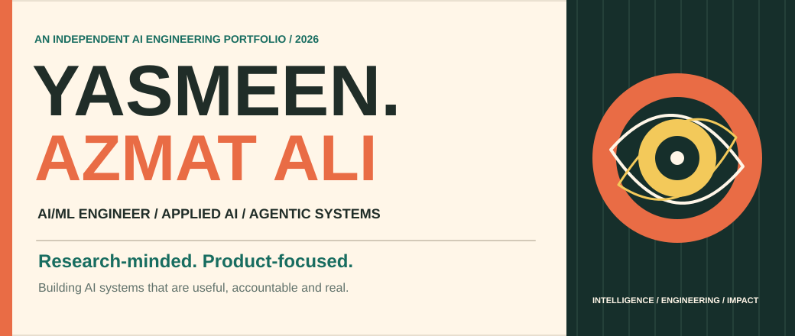

**AI/ML Engineer** &nbsp; / &nbsp; **Applied AI Developer** &nbsp; / &nbsp; **Agentic Systems**

Sharjah, UAE · Open to remote opportunities

<a href="https://yasmeenazmat.com/">Portfolio</a> &nbsp;·&nbsp; <a href="https://www.linkedin.com/in/yasmeen-azmat-a02b44340/">LinkedIn</a> &nbsp;·&nbsp; <a href="mailto:yasmeenazmat.ali97@icloud.com">Email</a> &nbsp;·&nbsp; <a href="https://github.com/yasmeenmh90-beep">GitHub</a> &nbsp;·&nbsp; <a href="https://www.youtube.com/@YasmeenAzmat-v6y">YouTube</a> &nbsp;·&nbsp; <a href="./Yasmeen_Azmat_Ali_CV.pdf">CV</a>

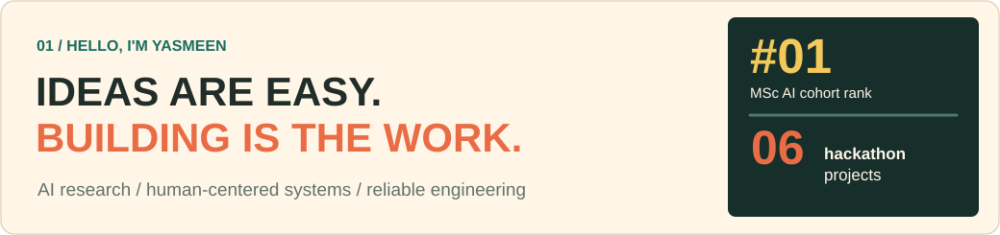

I'm an **AI/ML engineer** and **applied AI developer**, with an MSc in Artificial Intelligence (**First Class Distinction, ranked #1 in my cohort**). I build complete AI applications: **agentic architectures, retrieval-augmented generation, human-in-the-loop workflows, LLM security, real-time ML pipelines, APIs and interactive interfaces.**

> **Current interests:** multi-agent research, trustworthy AI, practical automation, document intelligence, AI operations, and backend systems that make intelligent tools usable.

### Six completed hackathon projects
Source code, demos and walkthroughs are linked below. Each card opens its repository.

<table>
<tr>
<td width="50%" valign="top"><a href="https://github.com/yasmeenmh90-beep/multi-agent-rag-research-assistant">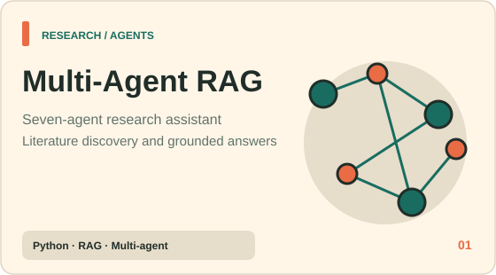</a> <b>Multi-Agent RAG</b> &nbsp; <a href="https://github.com/yasmeenmh90-beep/multi-agent-rag-research-assistant">Code</a> · <a href="https://rag-dashboard-mpr4.onrender.com">Live demo</a> · <a href="https://www.youtube.com/watch?v=jM5vrCund78&t=309s">Video</a></td>
<td width="50%" valign="top"><a href="https://github.com/yasmeenmh90-beep/invoiceguard">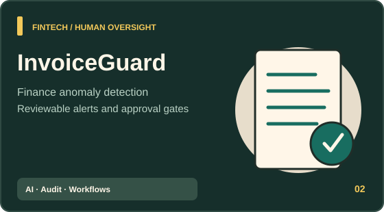</a> <b>InvoiceGuard</b> &nbsp; <a href="https://github.com/yasmeenmh90-beep/invoiceguard">Code</a> · <a href="https://invoiceguard-murex.vercel.app">Live demo</a> · <a href="https://www.youtube.com/watch?v=PPiI_tBXf6A&t=3s">Video</a></td>
</tr>
<tr>
<td width="50%" valign="top"><a href="https://github.com/yasmeenmh90-beep/Clerkly">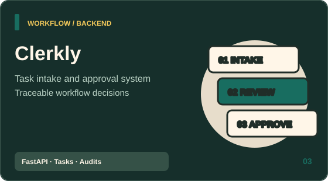</a> <b>Clerkly</b> &nbsp; <a href="https://github.com/yasmeenmh90-beep/Clerkly">Code</a> · <a href="https://clerkly-mu.vercel.app">Live demo</a> · <a href="https://www.youtube.com/watch?v=Qm3CAmAwrUo&t=25s">Video</a></td>
<td width="50%" valign="top"><a href="https://github.com/yasmeenmh90-beep/civicrelay">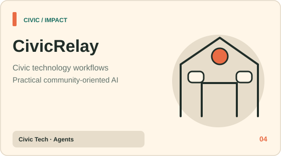</a> <b>CivicRelay</b> &nbsp; <a href="https://github.com/yasmeenmh90-beep/civicrelay">Code</a> · <a href="https://civic-relay.vercel.app">Live demo</a> · <a href="https://www.youtube.com/watch?v=IdlXDlYbDv4">Video</a></td>
</tr>
<tr>
<td width="50%" valign="top"><a href="https://github.com/yasmeenmh90-beep/AI-Career-Guidance-Assistant">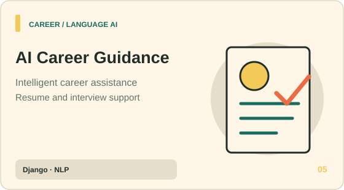</a> <b>AI Career Guidance</b> &nbsp; <a href="https://github.com/yasmeenmh90-beep/AI-Career-Guidance-Assistant">Code</a> · <a href="https://ai-career-guidance-assistant.onrender.com/login/?next=/">Live demo</a> · <a href="https://www.youtube.com/watch?v=AOR4rf9_e1Y">Video</a></td>
<td width="50%" valign="top"><a href="https://github.com/yasmeenmh90-beep/NVIDIA-agentops-ai">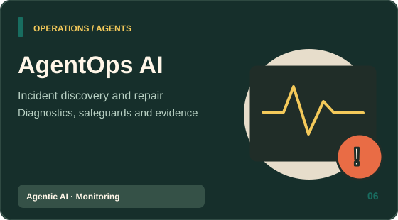</a> <b>AgentOps AI</b> &nbsp; <a href="https://github.com/yasmeenmh90-beep/NVIDIA-agentops-ai">Code</a> · <a href="https://nvidia-agentops-ai-1.onrender.com">Live demo</a> · <a href="https://www.youtube.com/watch?v=7trQKYdCTp4&t=11s">Video</a> · <a href="https://github.com/yasmeenmh90-beep/agentops-test-shop">Test repo</a> · <a href="https://github.com/yasmeenmh90-beep/agentops-test-shop/pulls">Repair evidence</a></td>
</tr>
</table>

**Hackathon snapshot:** 6 submitted projects · 1 solo / 5 team · 6 live demos · 6 video demos.

### QuantumLogics — internship work

<table>
<tr>
<td width="50%" valign="top"><a href="https://github.com/yasmeenmh90-beep/AI-Powered-Multi-Language-Code-Vulnerability-Scanner">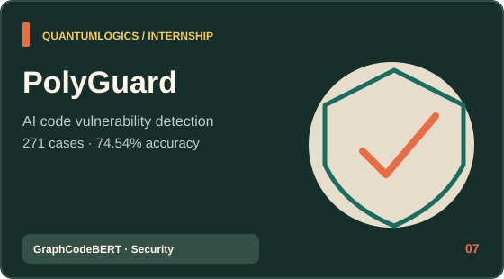</a> <b>PolyGuard</b> &nbsp; <a href="https://github.com/yasmeenmh90-beep/AI-Powered-Multi-Language-Code-Vulnerability-Scanner">Code</a></td>
<td width="50%"></td>
</tr>
</table>

**PolyGuard evaluation:** 271 hand-written test cases; **74.54% accuracy**, **77.50% precision**, **68.89% recall** and **72.94% F1** in project-specific evaluation.

### Syntecxhub — internship work

**WEEK 01 / SEARCH + RULES**

<table>
<tr>
<td width="50%" valign="top"><a href="https://github.com/yasmeenmh90-beep/Syntecxhub_Maze_Solver">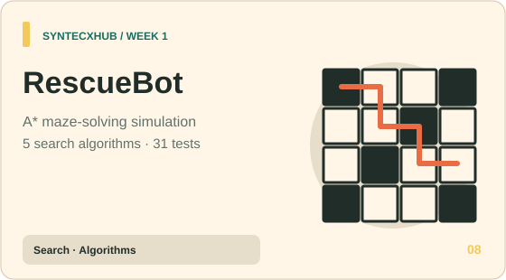</a> <b>RescueBot</b> &nbsp; <a href="https://github.com/yasmeenmh90-beep/Syntecxhub_Maze_Solver">Code</a></td>
<td width="50%" valign="top"><a href="https://github.com/yasmeenmh90-beep/Syntecxhub_PhishGuard">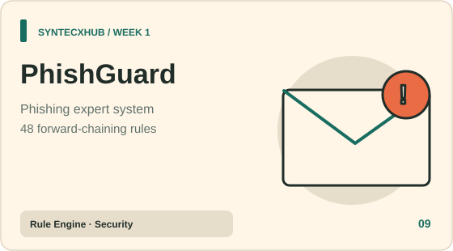</a> <b>PhishGuard</b> &nbsp; <a href="https://github.com/yasmeenmh90-beep/Syntecxhub_PhishGuard">Code</a></td>
</tr>
</table>

**WEEK 02 / NLP + DIALOGUE**

<table>
<tr>
<td width="50%" valign="top"><a href="https://github.com/yasmeenmh90-beep/Syntecxhub_Rule_Based_Chatbot">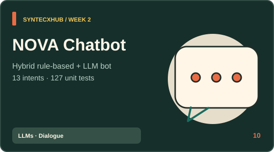</a> <b>NOVA Chatbot</b> &nbsp; <a href="https://github.com/yasmeenmh90-beep/Syntecxhub_Rule_Based_Chatbot">Code</a></td>
<td width="50%" valign="top"><a href="https://github.com/yasmeenmh90-beep/Syntecxhub_Sentiment_Analysis_Tool">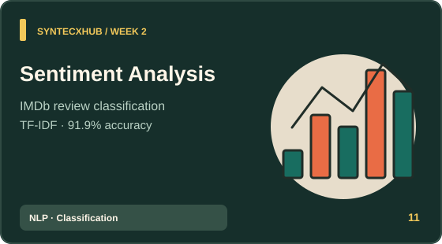</a> <b>Sentiment Analysis</b> &nbsp; <a href="https://github.com/yasmeenmh90-beep/Syntecxhub_Sentiment_Analysis_Tool">Code</a></td>
</tr>
</table>

**WEEK 03 / COMPUTER VISION**

<table>
<tr>
<td width="50%" valign="top"><a href="https://github.com/yasmeenmh90-beep/Syntecxhub_Face_Recognition">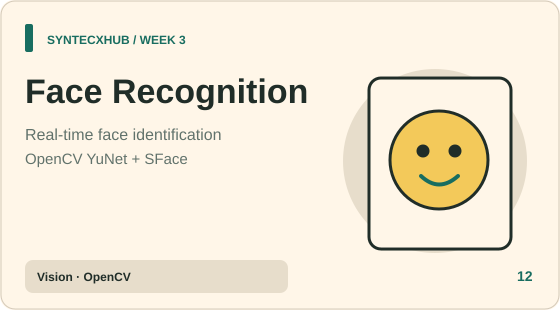</a> <b>Face Recognition</b> &nbsp; <a href="https://github.com/yasmeenmh90-beep/Syntecxhub_Face_Recognition">Code</a></td>
<td width="50%" valign="top"><a href="https://github.com/yasmeenmh90-beep/Syntecxhub_Hand_Gesture_Recognization">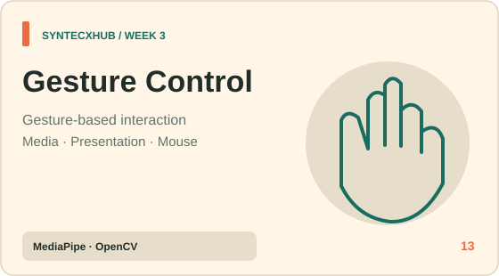</a> <b>Gesture Control</b> &nbsp; <a href="https://github.com/yasmeenmh90-beep/Syntecxhub_Hand_Gesture_Recognization">Code</a></td>
</tr>
</table>

### Featured AI projects

<table>
<tr>
<td width="50%" valign="top"><a href="https://github.com/yasmeenmh90-beep/PromptGuard-Automated-Security-Testing-for-LLM-Applications">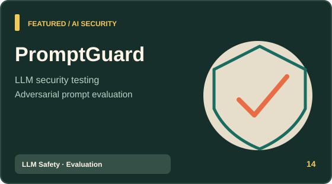</a> <b>PromptGuard</b> &nbsp; <a href="https://github.com/yasmeenmh90-beep/PromptGuard-Automated-Security-Testing-for-LLM-Applications">Code</a></td>
<td width="50%" valign="top"><a href="https://github.com/yasmeenmh90-beep/scoutly">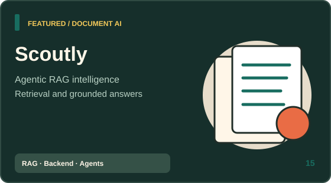</a> <b>Scoutly</b> &nbsp; <a href="https://github.com/yasmeenmh90-beep/scoutly">Code</a></td>
</tr>
</table>

### MSc Artificial Intelligence projects

<table>
<tr>
<td width="50%" valign="top"><a href="https://github.com/yasmeenmh90-beep/Real-Time-Twitter-Sentiment-Analysis">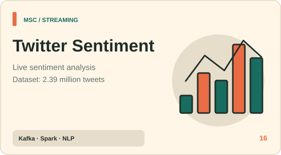</a> <b>Twitter Sentiment</b> &nbsp; <a href="https://github.com/yasmeenmh90-beep/Real-Time-Twitter-Sentiment-Analysis">Code</a></td>
<td width="50%" valign="top"><a href="https://github.com/yasmeenmh90-beep/spam-email-classification">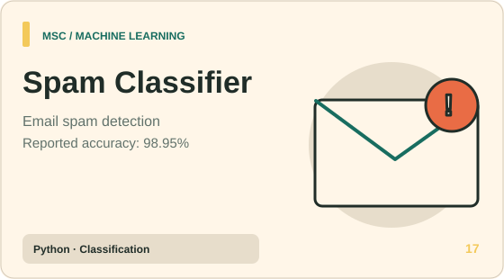</a> <b>Spam Classifier</b> &nbsp; <a href="https://github.com/yasmeenmh90-beep/spam-email-classification">Code</a></td>
</tr>
<tr>
<td width="50%" valign="top"><a href="https://github.com/yasmeenmh90-beep/responsible-ai-fairness-interpretability">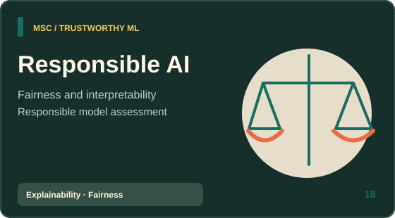</a> <b>Responsible AI</b> &nbsp; <a href="https://github.com/yasmeenmh90-beep/responsible-ai-fairness-interpretability">Code</a></td>
<td width="50%" valign="top"><a href="https://github.com/yasmeenmh90-beep/Titanic-Survival-Prediction-ML-Group-Project">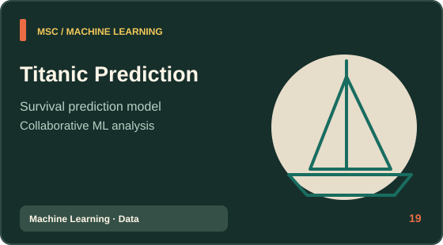</a> <b>Titanic Prediction</b> &nbsp; <a href="https://github.com/yasmeenmh90-beep/Titanic-Survival-Prediction-ML-Group-Project">Code</a></td>
</tr>
</table>

### Product experiments

<table>
<tr>
<td width="50%" valign="top"><a href="https://github.com/yasmeenmh90-beep/ai-interview-practice-bot">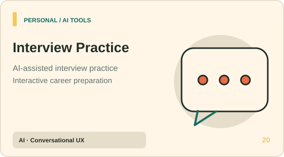</a> <b>Interview Practice</b> &nbsp; <a href="https://github.com/yasmeenmh90-beep/ai-interview-practice-bot">Code</a></td>
<td width="50%" valign="top"><a href="https://github.com/yasmeenmh90-beep/climate-weather-dashboard">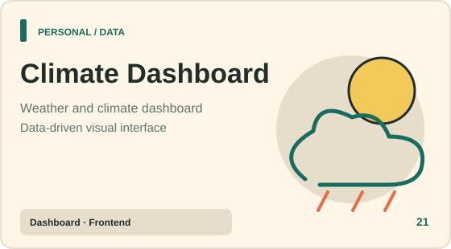</a> <b>Climate Dashboard</b> &nbsp; <a href="https://github.com/yasmeenmh90-beep/climate-weather-dashboard">Code</a></td>
</tr>
</table>

### Android applications

<table>
<tr>
<td width="50%" valign="top"><a href="https://github.com/yasmeenmh90-beep/MoodJournal">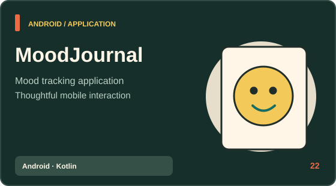</a> <b>MoodJournal</b> &nbsp; <a href="https://github.com/yasmeenmh90-beep/MoodJournal">Code</a></td>
<td width="50%" valign="top"><a href="https://github.com/yasmeenmh90-beep/QuizMaster">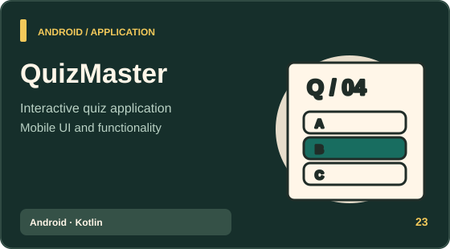</a> <b>QuizMaster</b> &nbsp; <a href="https://github.com/yasmeenmh90-beep/QuizMaster">Code</a></td>
</tr>
</table>

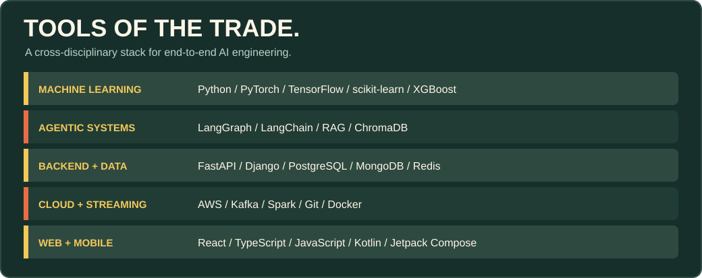

### Highlights worth sharing

| Focus | Evidence |
|:--|:--|
| MSc Artificial Intelligence | **First Class Distinction** · #1 cohort rank |
| Hackathons | **6** completed and submitted projects |
| CivicRelay | **116 / 116** passing tests |
| Spam classification | **98.95%** reported model accuracy |
| Streaming sentiment | **2.39M** tweets in the research dataset |
| PolyGuard | **271** hand-written evaluation cases; **72.94% F1** |

### GitHub activity

 

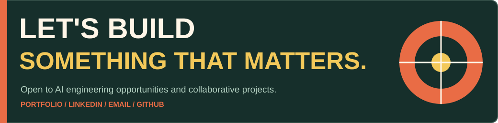

<a href="https://www.linkedin.com/in/yasmeen-azmat-a02b44340/">LinkedIn</a> &nbsp;·&nbsp; <a href="mailto:yasmeenazmat.ali97@icloud.com">Email</a> &nbsp;·&nbsp; <a href="https://yasmeen-portfolio-gamma.vercel.app">Portfolio (alternate)</a> &nbsp;·&nbsp; <a href="https://github.com/yasmeenmh90-beep">GitHub</a> &nbsp;·&nbsp; <a href="https://www.youtube.com/@YasmeenAzmat-v6y">YouTube</a>

