

  &nbsp;
  &nbsp;
  

📍 <b>Sharjah, UAE</b> &nbsp;|&nbsp; 🌍 <b>Open to Remote Opportunities</b>

  &nbsp;
  &nbsp;
  &nbsp;
  &nbsp;
  

---

## 👩‍💻 About Me

  

### 🎯 What I Work On

  

---

## 🧰 Tech Stack

  

---

# 🏆 Completed Hackathon Projects

> Five completed and submitted hackathon projects spanning **agentic AI, RAG, financial automation, civic technology and career intelligence**. Click any card to open the code.

<table>
<tr>
<td width="50%" align="center" valign="top">
<a href="https://github.com/yasmeenmh90-beep/multi-agent-rag-research-assistant"></a>
 
  
</td>
<td width="50%" align="center" valign="top">
<a href="https://github.com/yasmeenmh90-beep/invoiceguard"></a>
 
  
</td>
</tr>
<tr>
<td width="50%" align="center" valign="top">
<a href="https://github.com/yasmeenmh90-beep/Clerkly"></a>
 
  
</td>
<td width="50%" align="center" valign="top">
<a href="https://github.com/yasmeenmh90-beep/civicrelay"></a>
 
  
</td>
</tr>
<tr>
<td width="50%" align="center" valign="top">
<a href="https://github.com/yasmeenmh90-beep/AI-Career-Guidance-Assistant"></a>
 
  
</td>
<td width="50%" align="center" valign="top">
</td>
</tr>
</table>

---

# 💼 QuantumLogics Internship

  <a href="https://github.com/yasmeenmh90-beep/AI-Powered-Multi-Language-Code-Vulnerability-Scanner"></a>

  

---

# ⭐ Featured AI Projects

<table>
<tr>
<td width="50%" align="center" valign="top">
<a href="https://github.com/yasmeenmh90-beep/PromptGuard-Automated-Security-Testing-for-LLM-Applications"></a>
 

</td>
<td width="50%" align="center" valign="top">
<a href="https://github.com/yasmeenmh90-beep/scoutly"></a>
 

</td>
</tr>
</table>

---

# 🎓 MSc Artificial Intelligence Projects

<table>
<tr>
<td width="50%" align="center" valign="top">
<a href="https://github.com/yasmeenmh90-beep/Real-Time-Twitter-Sentiment-Analysis"></a>
 

</td>
<td width="50%" align="center" valign="top">
<a href="https://github.com/yasmeenmh90-beep/spam-email-classification"></a>
 

</td>
</tr>
<tr>
<td width="50%" align="center" valign="top">
<a href="https://github.com/yasmeenmh90-beep/responsible-ai-fairness-interpretability"></a>
 

</td>
<td width="50%" align="center" valign="top">
<a href="https://github.com/yasmeenmh90-beep/Titanic-Survival-Prediction-ML-Group-Project"></a>
 

</td>
</tr>
</table>

---

# 💻 Additional Projects

<table>
<tr>
<td width="50%" align="center" valign="top">
<a href="https://github.com/yasmeenmh90-beep/ai-interview-practice-bot"></a>
 

</td>
<td width="50%" align="center" valign="top">
<a href="https://github.com/yasmeenmh90-beep/climate-weather-dashboard"></a>
 

</td>
</tr>
</table>

---

# 📱 Android Development

<table>
<tr>
<td width="50%" align="center" valign="top">
<a href="https://github.com/yasmeenmh90-beep/MoodJournal"></a>
 

</td>
<td width="50%" align="center" valign="top">
<a href="https://github.com/yasmeenmh90-beep/QuizMaster"></a>
 

</td>
</tr>
</table>

---

# 🏅 Highlights

  

---

# 📊 GitHub Analytics

<table>
<tr>
<td width="50%" align="center"></td>
<td width="50%" align="center"></td>
</tr>
</table>

  

<picture>
  <source media="(prefers-color-scheme: dark)" srcset="https://raw.githubusercontent.com/yasmeenmh90-beep/yasmeenmh90-beep/output/snake-dark.svg"/>
  
</picture>

---


  

&nbsp;
&nbsp;
&nbsp;
&nbsp;

  

